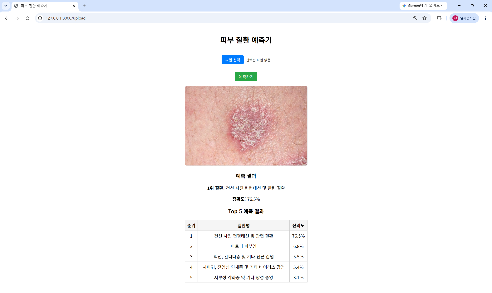
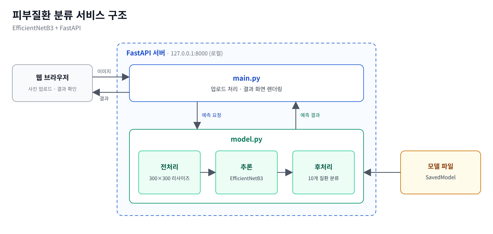
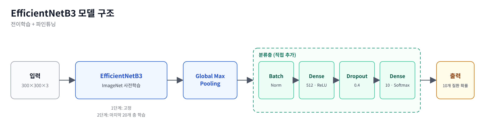
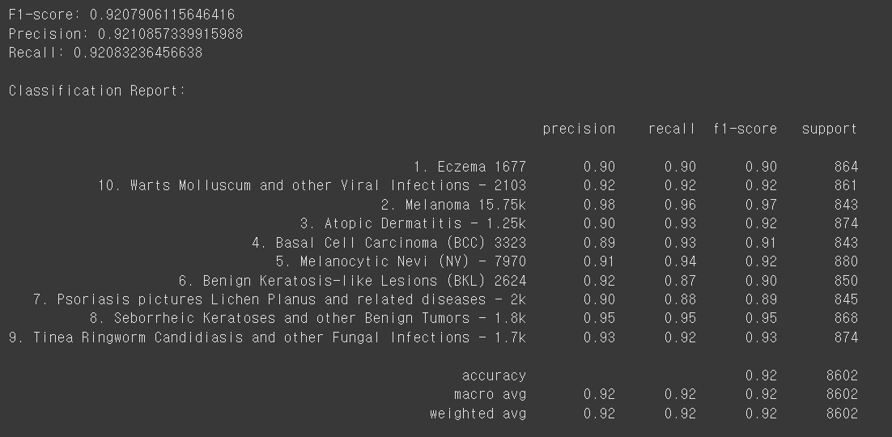

# 피부질환 분류 서비스

피부 사진을 업로드하면 10개 피부질환 중 어떤 질환인지 예측해 주는 웹 서비스입니다.  
4학년 졸업작품으로 진행했습니다.

## 화면

| 업로드 화면 | 결과 화면 |
|---|---|
|  |  |

## 구조



- `main.py` : 이미지 업로드 처리, 결과 화면 렌더링 (FastAPI + Jinja2)
- `model.py` : 전처리(300×300) → EfficientNetB3 추론 → 결과 반환

## 모델 학습



- 데이터: Kaggle 피부질환 이미지 데이터셋 (10개 클래스)
- 클래스 불균형 처리: 적은 클래스는 증강(회전, 이동, 확대, 좌우반전)으로 늘리고, 많은 클래스는 줄여서 개수를 맞춤
- 전처리: 비율 유지 리사이즈 + 패딩 (300×300), EfficientNet 전처리
- 데이터 분할: train 8 : val 2
- 모델: EfficientNetB3 (ImageNet 사전학습) + Dense 512 + Dropout 0.4 + Dense 10 (softmax)
- 학습: 1단계로 백본을 고정하고 분류층만 학습한 뒤, 2단계로 백본의 마지막 20개 층을 풀어 파인튜닝
- 설정: Adam, EarlyStopping, ReduceLROnPlateau
- 평가: Accuracy, Precision, Recall, F1-score
- 학습 환경: Google Colab (GPU)

## 모델 성능



## 기술 스택

- Python, FastAPI, Jinja2
- TensorFlow (EfficientNetB3, SavedModel)
- Pillow, scikit-learn
- Google Colab

## 실행 방법

```bash
cd SkinDiseaseClassifier
pip install -r requirements.txt
uvicorn main:app --reload
```

브라우저에서 `http://127.0.0.1:8000` 접속

## 참고

- 모델 파일(`SkinDiseaseClassifier/Model`)은 용량 문제로 저장소에 포함하지 않았습니다.
